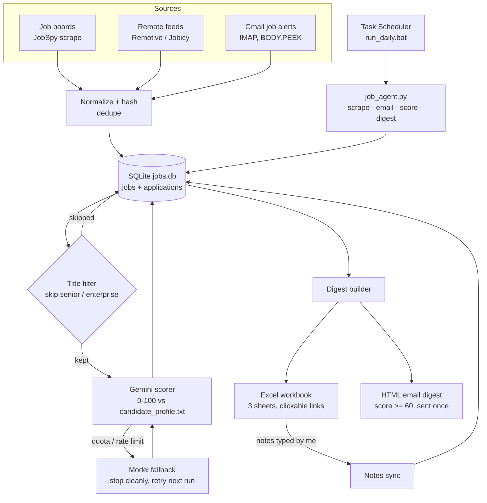

# Job Agent Workflow

A Python pipeline that finds cloud and support job listings, scores each one against my real skills with Gemini, and delivers a daily Excel and email digest. It runs unattended on a schedule and tracks applications and notes in SQLite.

   

## What it does

- Collects jobs from **job boards** (JobSpy), **remote feeds** (Remotive, Jobicy) and **email alerts** from portals that can't be scraped (Hirist, Instahyre, Foundit, Cutshort, Wellfound).
- De-duplicates jobs by a stable hash, so tracking parameters in LinkedIn or Indeed links don't create duplicates.
- Skips senior and enterprise titles before spending any API calls.
- Scores each remaining job 0-100 with Gemini, using only skills listed in `candidate_profile.txt`.
- Builds a 3-sheet Excel workbook and emails an HTML digest of jobs scoring 60 or above.
- Keeps notes typed into Excel in the database, so they survive every rebuild.

## Architecture



### Pipeline stages

| Stage | Command | What it does |
|---|---|---|
| scrape | `python job_agent.py --stage scrape` | Pulls listings from boards and remote feeds |
| email | `python job_agent.py --stage email` | Reads job-alert emails; only alert mails are marked read |
| score | `python job_agent.py --stage score` | Scores unscored rows with Gemini; each row is scored once |
| digest | `python job_agent.py --stage digest` | Writes the Excel file and emails the digest |

Running `python job_agent.py` with no arguments runs all four in order.

### Design decisions

- **Idempotent and resumable.** Rows stay `unscored` until a score is stored, so an API failure never loses a job.
- **Fails safe.** Quota exhaustion, an invalid API key, or an SMTP failure each stop that step cleanly. Rows are never marked as sent unless the email actually went out.
- **Honest scoring.** The scorer credits only skills I have used hands-on, so it can't inflate my fit.
- **Read-safe email access.** IMAP uses `BODY.PEEK`, so personal mail is never marked read.
- **Excel as a lightweight UI.** Notes typed in the last column are read back into the database on the next run. Type `-` to clear one.
- **Secrets stay out of git.** Keys live in `.env` (ignored). `.env.example` shows the variables. `security_audit.py` scans tracked and staged files for leaked keys, and `gitleaks` was run across the full history.

## Project layout

| File | Purpose |
|---|---|
| `job_agent.py` | Main pipeline and CLI (`--stage`) |
| `remote_feeds.py` | Remote job feed ingestion |
| `job_evaluator.py` | Scoring logic |
| `ats_finder.py` | Company ATS / career-page discovery |
| `weekly_summary.py` | Weekly summary email |
| `followup_reminder.py` | Application follow-up reminders |
| `networking_helper.py` | Networking helper |
| `check_key.py` | Verifies the Gemini key works |
| `test_pipeline.py` | Offline test suite, no accounts needed |
| `run_daily.bat` / `setup_automation.ps1` | Scheduling helpers |
| `daily_job_agent.yml` | GitHub Actions alternative (private repo only) |
| `candidate_profile.txt` | Skills the scorer is allowed to credit |
| `config.yaml` | Sites and settings |

## Setup (Windows)

```powershell
python -m venv .venv
.venv\Scripts\activate
pip install -r requirements.txt
copy .env.example .env
```

Fill in `.env` with `GEMINI_API_KEY` and a Gmail App Password (Google Account, Security, 2-Step Verification, App passwords). Then edit `candidate_profile.txt`, listing only skills you have actually used.

### Verify before trusting it

1. `py check_key.py` confirms the Gemini key works
2. `python test_pipeline.py` runs the offline checks
3. `python job_agent.py --stage scrape`; if a board returns 0 rows, drop it from the site list
4. `python job_agent.py --stage email`
5. `python job_agent.py --stage score` and spot-check 5-10 scores against the real posts
6. `python job_agent.py --stage digest`

### Schedule

Task Scheduler, Create Basic Task, daily at 8:00, action: start `run_daily.bat`. Output goes to `run_log.txt`.

## Tests

`test_pipeline.py` covers:

- job-id hashing and tracking-parameter handling
- email parsing and IMAP read-safety
- scoring, including the senior-title skip and quota/auth failure paths
- digest sending: SMTP failure, send-once, HTML escaping
- Excel output: sheets, links, and notes sync
- database migration from an older schema

## Re-scoring

To re-score everything after changing your profile (this re-emails all rows):

```bash
sqlite3 jobs.db "UPDATE jobs SET scored=0, emailed_in_digest=0"
```

## Roadmap

- Containerize the pipeline and run it on AWS (ECS scheduled task or Lambda + EventBridge)
- Move the database from SQLite to RDS or DynamoDB
- Send digests through SES
- Add CloudWatch logging and alarms for failed runs

## Tech

Python, SQLite, Google Gemini API, IMAP/SMTP, openpyxl (Excel), JobSpy, Windows Task Scheduler.
